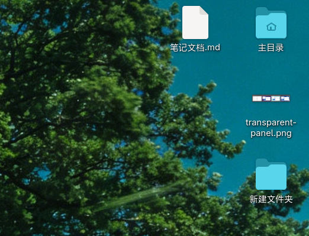

# Desktop Icons Next (DING)

[中文](README.md) | [English](README.en.md)

Desktop icons for GNOME Shell: files, folders, mounted volumes, Home and Trash live directly on the desktop,
with drag'n'drop, multi-selection, context menus, clipboard, keyboard control and search. DING stands for
Desktop Icons NG.

> **Notice**: this project is developed by LLMs (AI writes and debugs most of the code). It is for personal use
> only, comes with no stability guarantees and no external support.



*Actual screenshot: Home-folder emblem, image thumbnail, wrapped CJK label and label shadows.*

---

## Requirements

GNOME Shell 50 / 51 (see `shell-version` in `metadata.json`), GJS + GTK4 + Libadwaita, Nautilus.
Building needs `meson`, `ninja`, `xgettext`, `glib-compile-schemas`.

## Installation

```bash
bash scripts/local_install.sh                    # installs into ~/.local/
gnome-extensions enable desktop-icons-ng@icookie-tea.github.io
```

`Alt`+`F2` then `r` restarts the Shell on X11; Wayland needs a re-login. For a system-wide install use
`bash scripts/global_install.sh` (into `/usr`, needs sudo); multi-machine deployment is covered in
[docs/deployment.md](docs/deployment.md).

This extension uses its own UUID and can coexist with the distro-packaged `ding@rastersoft.com`, but only one
set of icons is shown, so enable only one in the Extensions app.

## Usage

- Drag and drop: free dragging on the desktop and to/from Nautilus windows; dropping text from an editor onto
  the desktop creates a `.txt` file
- Right-click: full desktop and per-icon menus (new item, paste, sort, properties, open in terminal…),
  "Open with…" also for several selected files
- Appearance: selection ring, rubber band and drop preview can follow the system accent colour; icons and
  labels have shadows so they stay readable on light wallpapers; hover or click a truncated name to read it
- Multiple displays: by default icons are spread over all displays; with "primary display only" they exist on
  one display only, and positions are stored as proportional anchors, so changing the primary display, the
  resolution or the scale, and hot-plugging monitors never move your icons
- Keyboard: `Ctrl`+`F` search, `Ctrl`+`H` hidden files, `Ctrl`+`C/X/V` copy/cut/paste, `Ctrl`+`+`/`-` icon size

The 16 gsettings keys with their defaults and the full shortcut table are in
[docs/settings-and-shortcuts.md](docs/settings-and-shortcuts.md). Clicking the gear of this extension opens the
desktop process' own settings window (`prefs.js:24-28` activates it over D-Bus and closes the extension
preferences) — that is intentional.

## Development

```bash
npm install              # ESLint, once
bash scripts/check.sh    # lint + syntax + gjs unit tests + standalone smoke test + structural guards
bash scripts/refresh_extension.sh
```

Architecture: the Shell extension (root JS files) handles the window type, the usable desktop area and the
process lifecycle; the GTK4 desktop process (`app/`) handles icons, grid layout, drag and drop, menus,
clipboard, thumbnails and the settings window, and the two talk over D-Bus. Under Wayland an application can
neither set its own window role nor learn about monitors and the window stack, which is why this split exists.
See [docs/architecture-analysis.md](docs/architecture-analysis.md).

When adding / moving / deleting a JS file, update the `meson.build` install lists as well, otherwise the build
succeeds but the runtime fails with `No JS module ... found`. Scripts: [scripts/README.md](scripts/README.md).
Docs index: [docs/README.md](docs/README.md); after fixing a bug, update [docs/fixes.md](docs/fixes.md).

## License and credits

GPL-3, see [COPYING](COPYING). This project evolved from the GPL-3 code of Desktop Icons NG (DING, original
author Sergio Costas, <https://gitlab.com/rastersoft/desktop-icons-ng>).

## Contact

icookie (maintainer) <1024494987@qq.com>
<https://github.com/icookie-tea/desktop-icons-ng>
