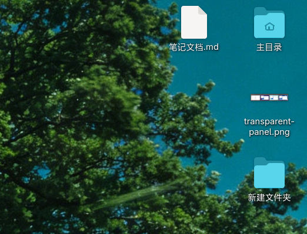

# Desktop Icons Next (DING)

[中文](README.md) | [English](README.en.md)

GNOME Shell 的桌面图标：文件、文件夹、挂载卷、主目录、垃圾桶直接显示在桌面上，支持拖拽、多选、右键菜单、
剪贴板、键盘操作和搜索。DING 即 Desktop Icons NG。

> **声明**：本项目由 LLM 开发（代码主要由 AI 编写与调试），仅供个人使用，不保证稳定性，也不提供对外支持。



*实际截图：主目录徽标、图片缩略图、中文长标签换行、标签阴影。*

---

## 运行要求

GNOME Shell 50 / 51（见 `metadata.json` 的 `shell-version`）、GJS + GTK4 + Libadwaita、Nautilus。
构建需要 `meson`、`ninja`、`xgettext`、`glib-compile-schemas`。

## 安装

```bash
bash scripts/local_install.sh                    # 装到 ~/.local/
gnome-extensions enable desktop-icons-ng@icookie-tea.github.io
```

X11 下 `Alt`+`F2` 输入 `r` 重载 Shell；Wayland 需注销登录。系统级安装用 `bash scripts/global_install.sh`
（装到 `/usr`，需 sudo），多台机器部署见 [docs/deployment.md](docs/deployment.md)。

与发行版自带的 `ding@rastersoft.com` 使用不同 UUID，可以共存但只会显示一套图标，请在扩展应用中只启用一个。

## 使用

- 拖拽：桌面内自由拖动，也可与 Nautilus 窗口互拖；从编辑器拖一段文本到桌面会生成 `.txt`
- 右键：桌面与图标的完整菜单（新建、粘贴、排序、属性、在终端中打开…），支持多个文件"打开方式"
- 外观：选框/框选/拖放预览跟随系统强调色；图标与标签带阴影，浅色壁纸上也清晰；长名称悬停或点击看全文
- 多显示器：默认在所有显示器铺开图标；开启"仅主显示器"后图标只存在于主屏，位置按比例锚点保存，
  切换主屏、改分辨率或缩放、热插拔都不会改变已保存位置
- 键盘：`Ctrl`+`F` 搜索，`Ctrl`+`H` 显示隐藏文件，`Ctrl`+`C/X/V` 复制/剪切/粘贴，`Ctrl`+`+`/`-` 调整图标大小

设置项清单（16 项 gsettings 键与默认值）和完整快捷键表见
[docs/settings-and-shortcuts.md](docs/settings-and-shortcuts.md)。
点击扩展的齿轮打开的是桌面进程自己的设置窗口（`prefs.js:24-28` 通过 D-Bus 唤起后关闭扩展偏好窗口），
这是有意为之。

## 开发

```bash
npm install              # ESLint，仅需一次
bash scripts/check.sh    # lint + 语法 + gjs 单元测试 + 独立进程冒烟 + 结构守卫
bash scripts/refresh_extension.sh
```

架构：Shell 扩展（根目录 JS）负责窗口类型、桌面区域计算与进程生死；GTK4 桌面进程（`app/`）负责图标、
网格布局、拖放、菜单、剪贴板、缩略图与设置窗口，两者通过 D-Bus 通信。Wayland 下应用无法自行设定窗口角色、
也无法获知监视器与窗口堆栈信息，这正是双层设计的由来。详见
[docs/architecture-analysis.md](docs/architecture-analysis.md)。

新增 / 移动 / 删除 JS 文件时必须同步更新 `meson.build` 安装清单，否则构建能过但运行时报
`No JS module ... found`。脚本清单见 [scripts/README.md](scripts/README.md)，文档索引见
[docs/README.md](docs/README.md)，修 bug 后按约定更新 [docs/fixes.md](docs/fixes.md)。

## 许可与致谢

GPL-3，见 [COPYING](COPYING)。本仓库由 Desktop Icons NG（DING，原作者 Sergio Costas，
<https://gitlab.com/rastersoft/desktop-icons-ng>）的 GPL-3 代码演进而来。

## 联系

icookie（维护者）<1024494987@qq.com>
<https://github.com/icookie-tea/desktop-icons-ng>
